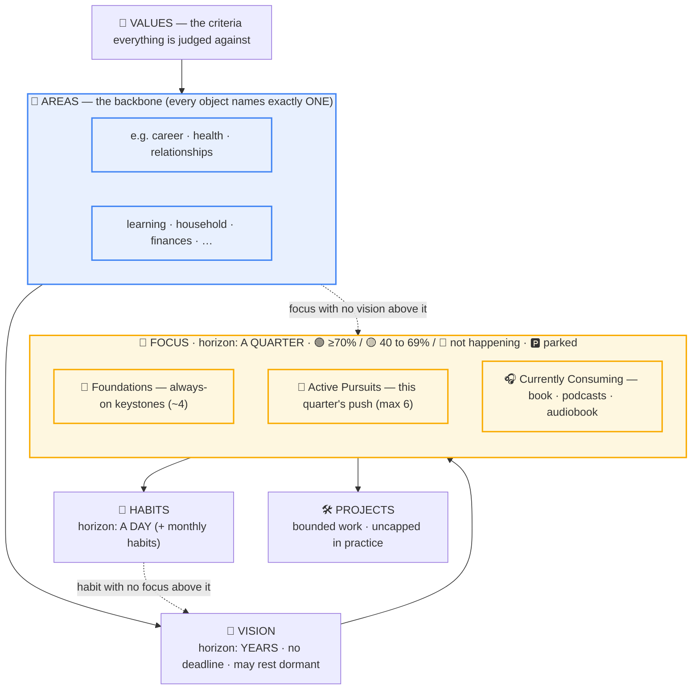
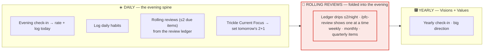

# System Map

The one-page picture of the whole PFC system — **what the parts are, how they nest, and when you touch each one.** This is a core artifact: when the system is confusing, come here first. Both diagrams are Mermaid source, so they stay editable and regenerate on any viewer.

## The whole system in one breath

> **Everything belongs to one Area. Vision = years, Focus = a quarter, Habit = a day. Every Focus names at least one Habit as its vehicle, and wears a traffic light DERIVED from that habit's rate (🟢 ≥70% · 🟡 40–69% · 🔴 <40%). Red means not happening; a deliberate stop is `parked` 🅿️.**

## 1. Structure — how the layers nest

**The four altitudes, under one Area:**

| Layer | Horizon | One line | Example |
|---|---|---|---|
| **Area** | permanent | where this lives; the backbone | Learning |
| **Vision** | years (no deadline) | where I'm headed; may rest dormant | Become conversational in Spanish |
| **Focus** | a quarter | what I'm actually on now; scarce, capped, traffic-lit | Spanish 🟢 |
| **Habit** | a day | today's rep; binary log | Practiced Spanish 15 min |

**The linking rule:** every object names exactly one Area (nothing floats). Upward links (Vision→Focus, Focus→Project) are optional, recorded only when real, never invented — **link to your nearest real parent, one hop up, never double-link.** The chain gives you everything above it transitively.

**The Focus→Habit link is the exception: it is REQUIRED.** Every active Foundation and Pursuit declares `habits: [...]` — an ordered list of vehicle habits, first one primary. Without a vehicle a Focus cannot be measured, and an unmeasured Focus displays green forever while nothing happens. `scripts/validate.sh` fails on a vehicle-less Focus. See [`habit-mechanics.md`](habit-mechanics.md).

### The three intention layers — every commitment has a gauge

Everything you *commit to doing* (as opposed to direction or criteria) lives in exactly one of three operational layers. Each has its own horizon and its own gauge, so "am I doing what I said?" is always a read-off, never a feeling:

| Layer | Horizon | The commitment | The gauge |
|---|---|---|---|
| **Focus** | a quarter | "I'm actively on this now" | traffic light (🟢/🟡/🔴, derived from the vehicle habit's rate) |
| **Projects** | 1–3 months | "I'm building this bounded thing" | percent complete · velocity · days idle |
| **Habits** | a day / a month | "I do this repeatedly" | completion rate vs frequency |

Above these sit Values, Areas, and Visions — criteria and direction, deliberately *ungauged* (a vision has no deadline and cannot "slip"). Below them sit tasks — execution detail, gauged only through the 2+1.

Two recovery surfaces read all three gauges together, so an off-track intention can't hide in a layer nobody is watching: the optional web home page's **Focuses, Projects and Habits bands**, mirrored by the TRMNL screens, Trello lists and reMarkable pages that show the same bands (the whole set, ambient; project velocity and days idle from `automations/scripts/project_gauges.py`, the one home of both rules), and the **evening check-in's back-on-track step** (one re-entry step per night, from the item's landing anchor).

**The don't-multiply-concepts guard:** when adding any new commitment type, gauge, or surface, first name which of the three layers it belongs to. If it fits none, it is probably a new concept the system doesn't need.

## 2. Cadence — when you touch each layer

| Cadence | What happens | Which layer it touches |
|---|---|---|
| **Daily (the evening spine)** | Evening check-in: rate + log today · log habits · rolling reviews (≤2 due) · trickle Focus · set tomorrow's 2+1 | Habits + today's Focus |
| **Rolling reviews** | Ledger (`data/review-ledger.ndjson`) drips ≤2 due items per evening; `/pfc-review` (and the web `/review` page) shows one due review at a time as a form. Weekly items (stale-task triage, focus accuracy…), monthly (life wheel, project progress, vision activation…), quarterly (re-pick Focuses, vision brainstorm, strengths). | Focus · Visions · monthly Habits |
| **Yearly** | Yearly check-in · big direction | Visions + Values |

Daily *reminds*; the quarterly Focus re-pick (a rolling-review item) *decides*.

## 3. The three Focus tiers

Tiers are horizontal bands by *role*; each focus is also tagged by its Area (the grouping within).

| Tier | Identity | Cap (defaults in `config/focus.yaml`) |
|---|---|---|
| 🧱 **Foundations** | what stays on no matter what | soft ~4 |
| 🎯 **Active Pursuits** | what I'm advancing this quarter | **hard 6** |
| 🎧 **Currently Consuming** | what I'm reading / listening to | book 1 · podcasts 3 · audiobook 1 |

## Other artifacts (not in the spine)

- **Front of Mind** (`data/grounding.ndjson` → `🧠 Front of mind` Trello list) — critical psychological anchors to stay grounded in. A sibling to Current Focus, different job.
- **Journal / area notes** (`2-areas/**`) — impromptu, daily-as-needed capture. Not scheduled.
- **Area items** (`2-areas/`): Time and Status items per area that compute the area's green, yellow or red light; answered in the `life-wheel` review. Rules: [`2-areas/AGENTS.md`](../2-areas/AGENTS.md).
- **Insights / Hypotheses / Findings** (`data/`) — the self-experimentation knowledge layer.
- **Day tracking** (`data/day-tracking.ndjson`) — the daily metrics feeding trend analysis.
