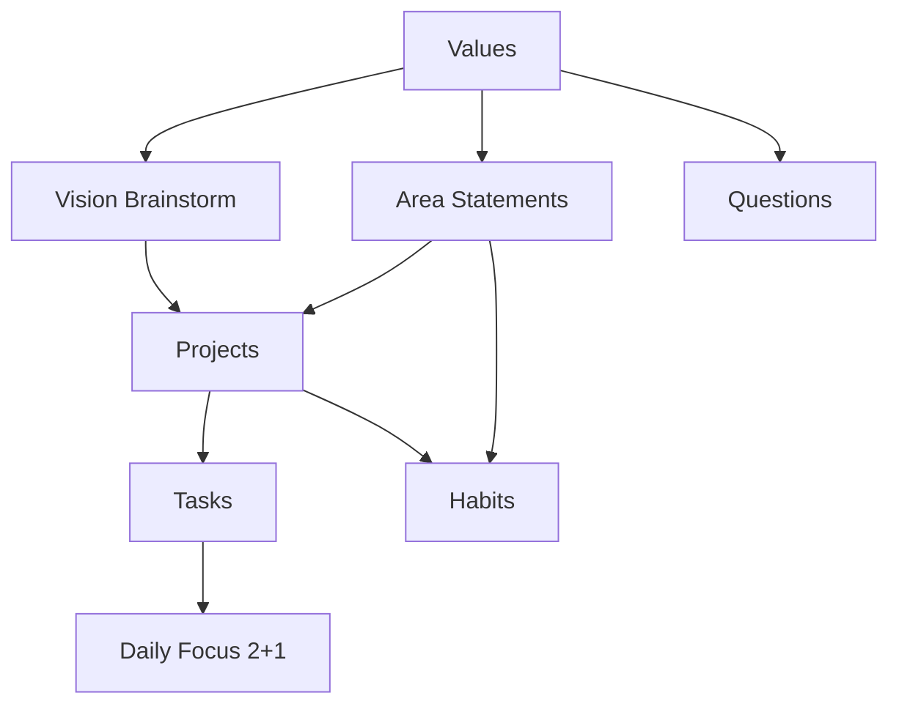
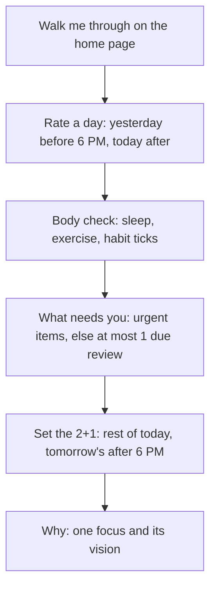
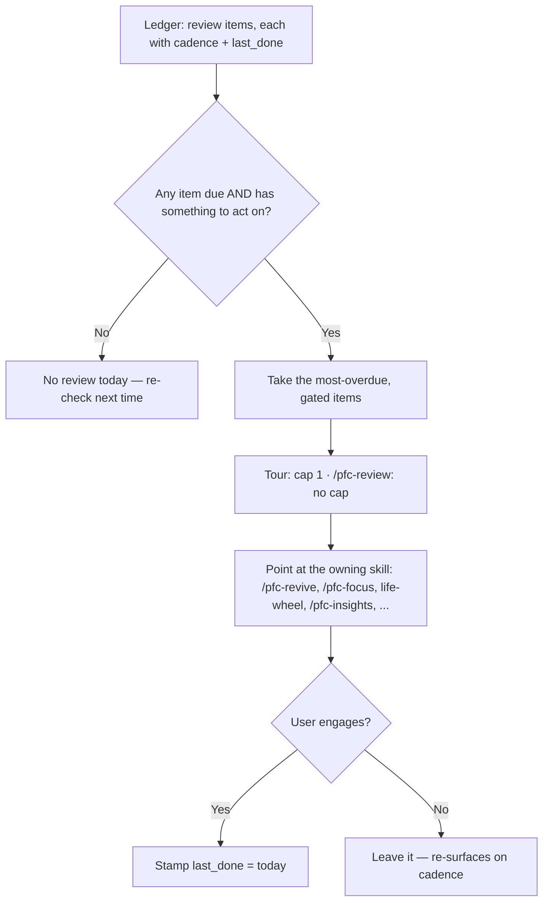
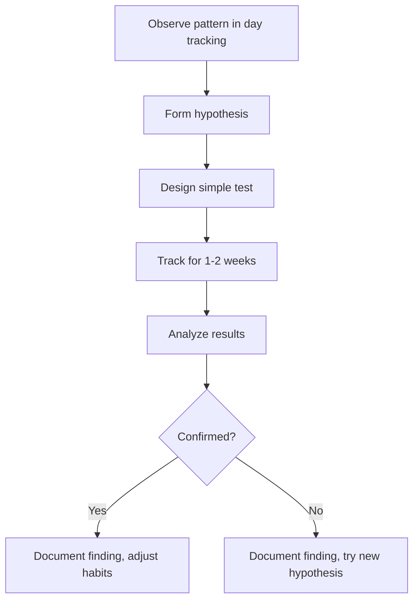

# Workflows

Visual documentation of how the productivity system works. Diagrams use Mermaid syntax.

## System Flow — Values to Tasks

## Daily Flow — the tour, any time

Each answer is saved and pushed by `automations/scripts/web_write.py` the moment it is given.

## Rolling Reviews Flow

The old weekly and monthly ritual reviews are folded into a rolling ledger (`data/review-ledger.ndjson`). The tour shows at most 1 due item; `/pfc-review` clears the whole backlog at once.

## Hypothesis Testing Flow

