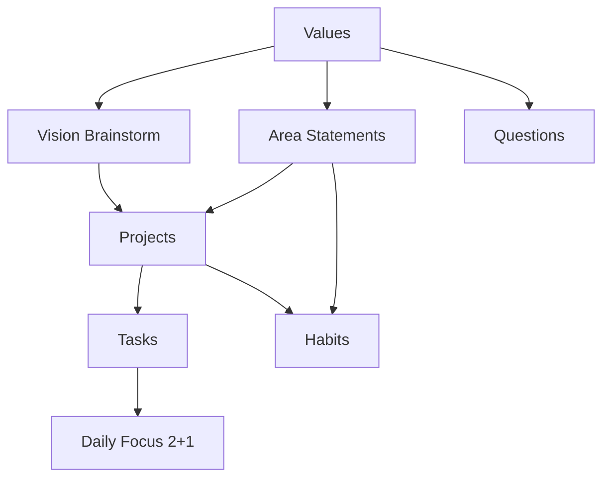
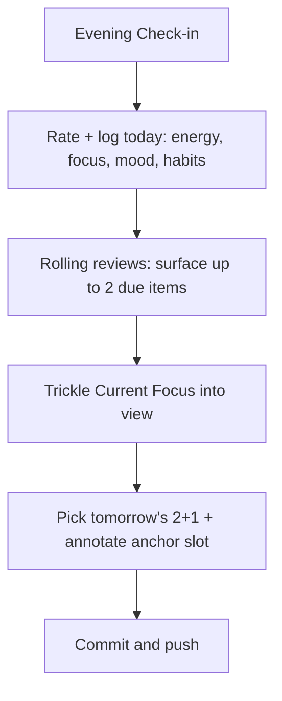
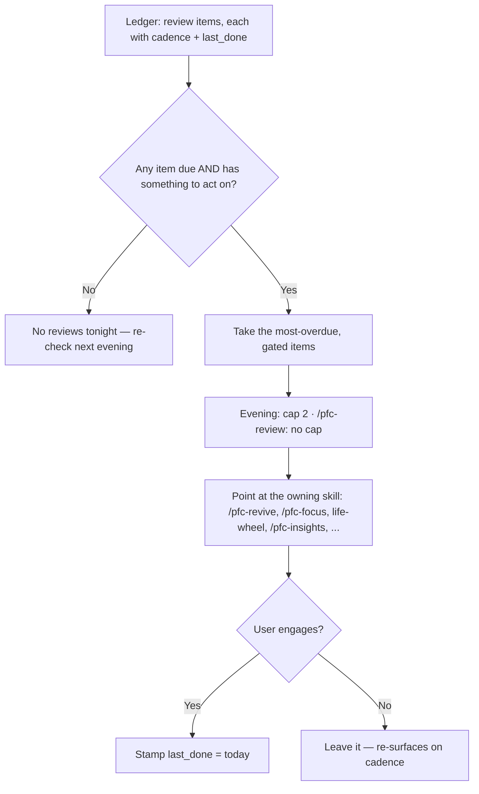
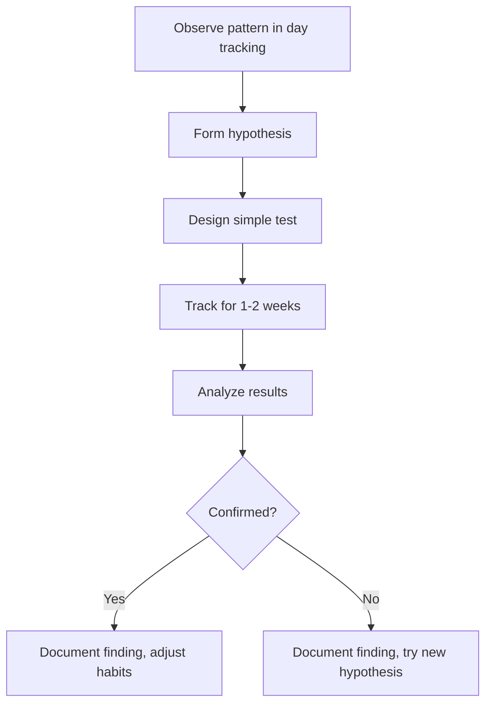

# Workflows

Visual documentation of how the productivity system works. Diagrams use Mermaid syntax.

## System Flow — Values to Actions

## Daily Flow — the evening spine

## Rolling Reviews Flow

The old weekly and monthly ritual reviews are folded into a rolling ledger (`data/review-ledger.ndjson`). The evening check-in drips ≤2 due items per night; `/pfc-review` clears the whole backlog at once.

## Hypothesis Testing Flow

