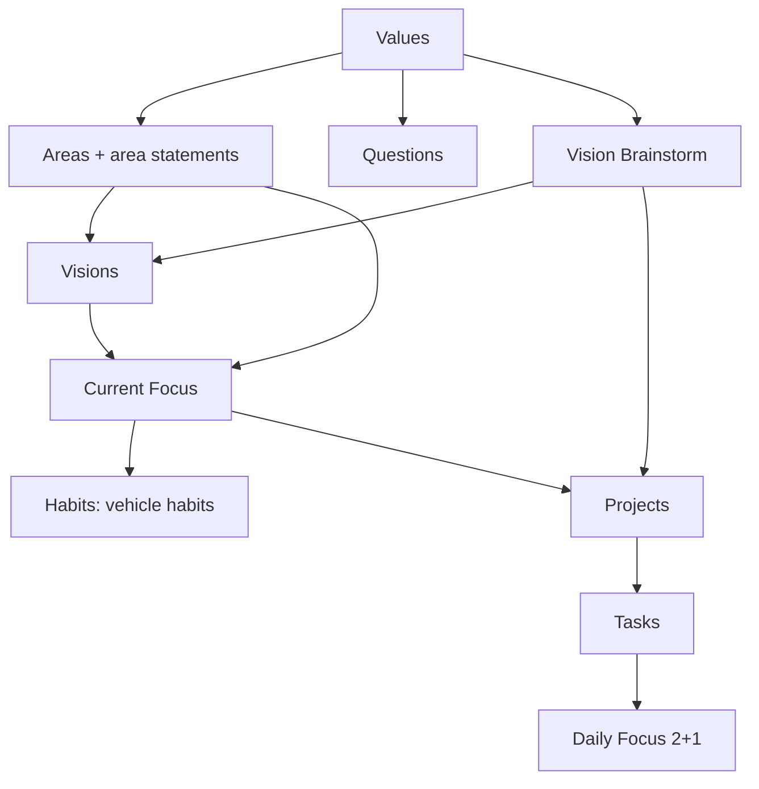
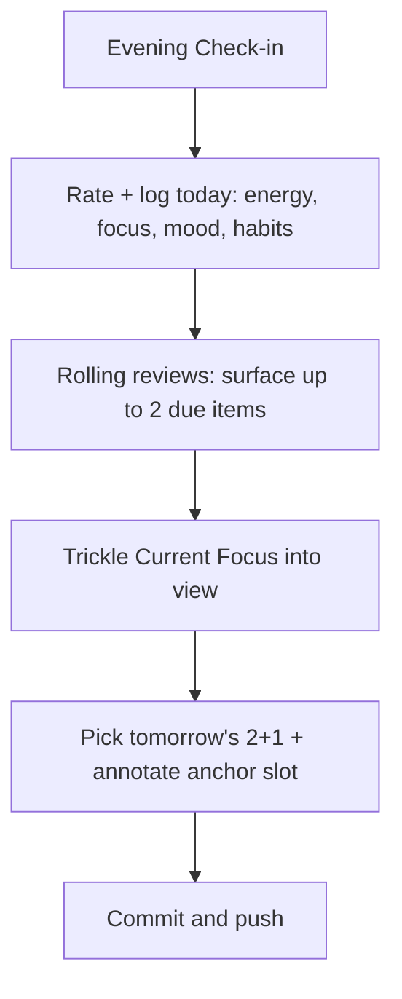
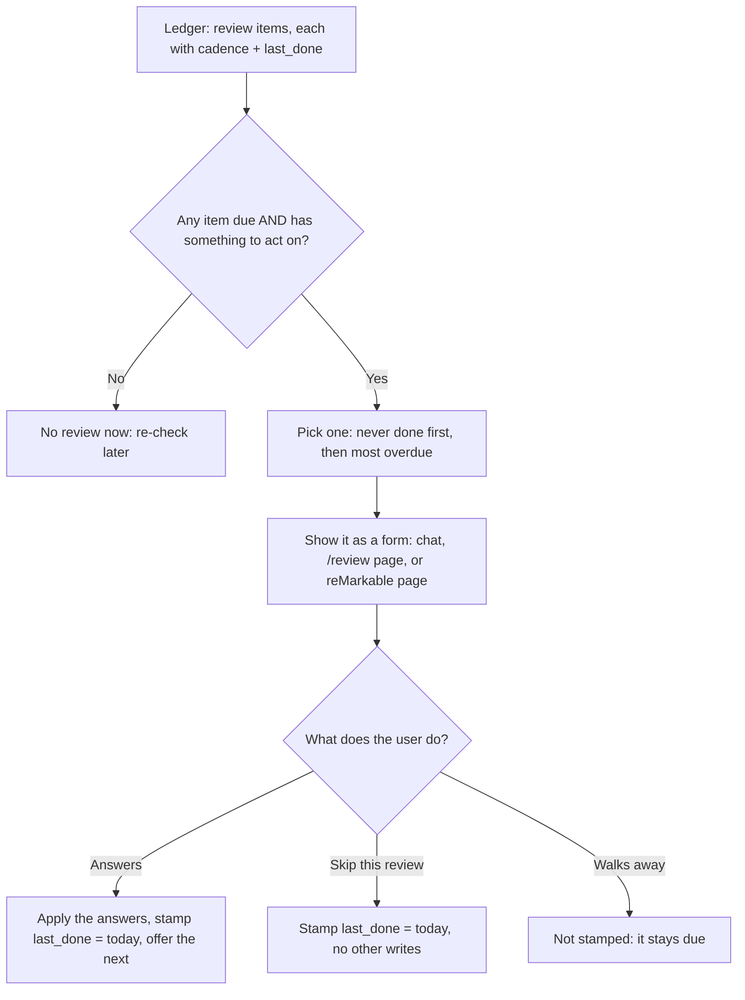
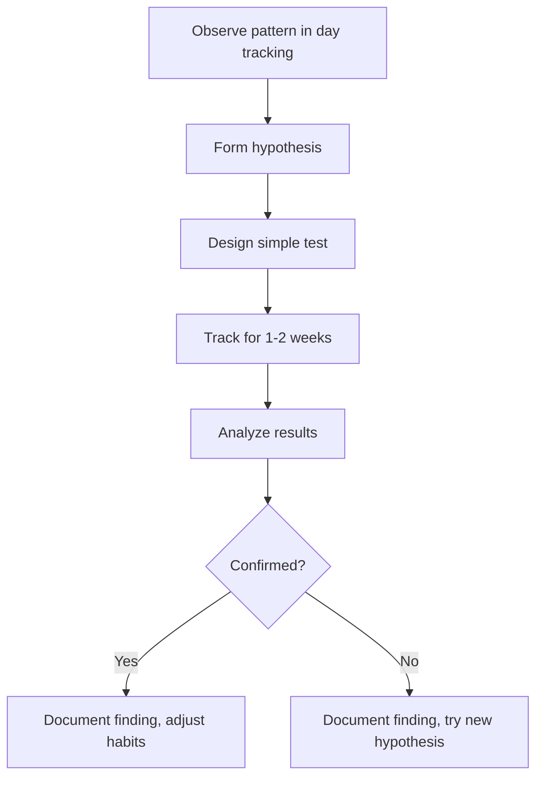

# Workflows

Visual documentation of how the productivity system works. Diagrams use Mermaid syntax.

## System Flow — Values to Tasks

The layers follow the VAVFPTH model (Values, Areas, Visions, Focus, Projects, Tasks, Habits). Links between layers are optional except Focus to Habits: every active focus names its vehicle habits.

## Daily Flow — the evening spine

The optional web home page, the Trello board and the reMarkable pages run parts of the same loop with buttons, ticks or ink (rate the day, log habits, set the 2+1, answer the due review). They write the same files, so anything already done there is not asked again in the check-in.

## Rolling Reviews Flow

The old weekly and monthly ritual reviews are folded into a rolling ledger (`data/review-ledger.ndjson`). The evening check-in drips ≤2 due items per night. `/pfc-review`, the web UI's `/review` page and the reMarkable `4 - Review` page each show one due review at a time as a short form, picked by `automations/scripts/review_forms.py`; say "next" in chat to clear a backlog.

## Hypothesis Testing Flow

